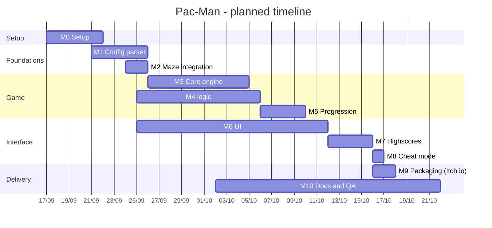

# Project Timeline (Planned)

- **Project start:** 2026-09-17
- **Target delivery:** 2026-10-18
- **Team:** mn-khili, maissam
- **Method:** feature-branch workflow: each feature/milestone below was developed on its own Git branch, then merged into the main branch once it worked.

## 1. Milestones

| #   | Milestone        | Content                                                                                                                                      | Start | End   | Owner    | Depends on |
| --- | ---------------- | -------------------------------------------------------------------------------------------------------------------------------------------- | ----- | ----- | -------- | ---------- |
| M0  | Setup            | Git repo, `.gitignore`, folder structure, project analysis                                                                                   | 09-17 | 09-21 | mn-khili | -          |
| M1  | Config           | JSON-with-comments parser (`#`), defaults/clamping, clean error messages, no traceback                                                       | 09-21 | 09-25 | mn-khili | M0         |
| M2  | Maze integration | Install assigned A-Maze-ing package as-is, and load it                                                                                       | 09-24 | 09-25 | mn-khili | M0         |
| M3  | Core engine      | Grid model, player movement (arrows/WASD), wall collisions, game loop, basic rendering                                                       | 09-17 | 09-25 | maissam  | M1, M2     |
| M4  | logic            | Pacgums, super-pacgums in 4 corners, 4 ghosts, ghost AI (chase / flee), edible state, respawn, lives, scoring                                | 09-25 | 10-06 | mn-khili | M3         |
| M5  | Progression      | 10+ levels, level timer, timeout rule, score/lives kept between levels, pause/resume, win/lose conditions                                    | 10-06 | 10-10 | maissam  | M4         |
| M6  | UI               | Main menu, HUD (score, lives, level, time), pause menu, game over + victory screens, instructions screen                                     | 09-25 | 10-12 | maissam  | M3         |
| M7  | Highscores       | Persistent top 10, name validation (max 10 chars, alphanumeric + spaces), robust to missing/corrupt file, name entry screen, display in menu | 10-12 | 10-16 | maissam  | M5, M6     |
| M8  | Cheat mode       | Invincibility, level skip, ghost freeze, extra lives, speed boost                                                                            | 10-16 | 10-16 | maissam  | M5         |
| M9  | Packaging        | Packaging script/spec at repo root, build, upload as unlisted/private on Itch.io, test install from the platform                             | 10-16 | 10-17 | mn-khili | M7, M8     |
| M10 | Docs and QA      | README (all required sections), project management docs, full acceptance test run, bug fixing, peer dry-run                                  | 10-02 | 11-18 | all      | continuous |

## 2. Gantt chart

## 3. Critical path

`M0 -> M2 -> M3 -> M4 -> M5 -> M7 -> M9 -> M11`

## 4. Planning decisions

- **Early :** maze integration and config parsing come first because the config will change during the defense and the generator is out of our control.
- **Parallel work:** UI (M6) and logic (M4) can progress in parallel once the core engine exists.
- **Docs and QA run continuously** (M10) instead of being squeezed in the last days.
